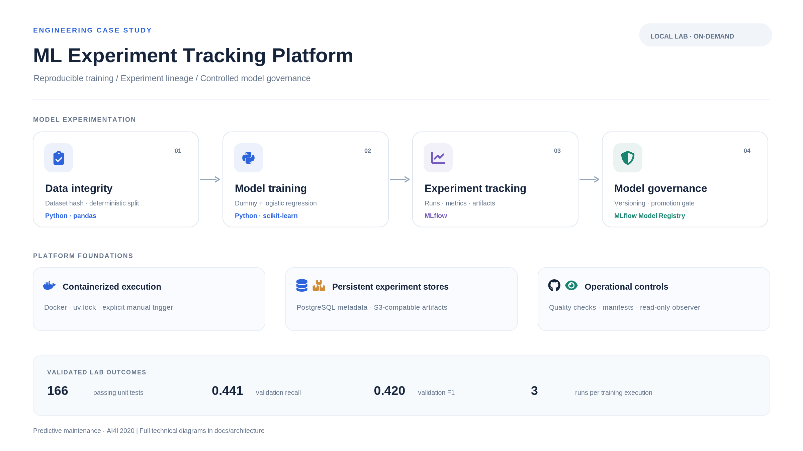

# ML Experiment Tracking Platform

**Reproducible machine learning experimentation, model governance, and operational reliability.**

An end-to-end MLOps engineering project built around predictive maintenance. The platform demonstrates how to move from isolated model training scripts to a traceable, reproducible, and controlled experimentation workflow.

**Python 3.12** · **scikit-learn** · **MLflow** · **Docker** · **PostgreSQL** · **S3-compatible Storage** · **GitHub Actions**

---

## Overview

Training a machine learning model is only one part of the challenge. Managing experiments, reproducing results, validating candidates, and understanding failures requires an engineering platform around the model.

This project addresses those challenges through a modular MLOps workflow with:

- **Reproducibility:** version-controlled code, locked dependencies, deterministic data splits, and dataset integrity checks.
- **Experiment tracking:** centralized runs, parameters, metrics, and artifacts using MLflow.
- **Model governance:** registered model versions, explicit selection criteria, and validation gates.
- **Operational reliability:** containerized execution, automated tests, structured observability, and failure evidence.

The use case is binary equipment failure prediction using the **AI4I 2020 Predictive Maintenance Dataset**.

## Architecture



The workflow connects data validation, model training, experiment tracking, and model governance, supported by containerized execution and persistent experiment storage.

Training can run locally or inside Docker, while MLflow persists experiment metadata in PostgreSQL and artifacts in S3-compatible storage.

**[Explore the architecture](docs/architecture/README.md)** · **[Edit the overview diagram](docs/architecture/overview.drawio)**

## Results

The project evaluates a Dummy Classifier and Logistic Regression using a reproducible training and validation workflow.

| Metric | Selected model |
|---|---:|
| Validation Recall | **0.4412** |
| Validation Precision | **0.4000** |
| Validation F1-score | **0.4196** |
| Decision Threshold | **0.20** |

The selection policy requires validation recall of at least **0.40**, with no more than **50 false positives**. The selected model satisfies both criteria.

The separate held-out test evaluation achieved **0.5000 recall** and **0.4722 F1-score**. The test partition was not used for threshold selection.

### Engineering outcomes

| Capability | Implementation |
|---|---|
| Automated quality checks | 166 passing tests, Ruff linting and formatting |
| Reproducible experiments | Seeded data splits and SHA-256 dataset verification |
| Experiment tracking | MLflow runs, metrics, parameters, and artifacts |
| Model lifecycle | Versioned registry, validation gates, and explicit demo transitions |
| Training execution | Local Python and hardened Docker container |
| Observability | Structured JSON events and read-only execution verification |
| Failure handling | Nonzero exit codes, failure manifests, and controlled fault injection |
| CI | On-demand GitHub Actions quality workflow |

## Engineering Decisions

The platform intentionally favors **clear boundaries, reproducibility, and maintainability** over unnecessary infrastructure complexity.

**Separation of concerns**

Data validation, model training, experiment tracking, governance, and operational checks are implemented as distinct responsibilities.

**Explicit model selection**

Evaluation policies are defined and tested independently of training. Model eligibility is not treated as automatic deployment approval.

**Portable execution**

The same training workflow can execute locally or inside a Docker container with locked dependencies.

**Traceable experiment lineage**

Execution identifiers connect MLflow runs to dataset hashes, source revisions, metrics, and local execution manifests.

**Failure visibility**

Execution failures produce structured evidence rather than relying exclusively on terminal output.

The architecture provides a foundation for future orchestration and deployment workflows without introducing Kubernetes or workflow engines where they are not yet needed.

## Getting Started

### Prerequisites

- Linux or WSL2
- Docker Engine with Docker Compose
- Python 3.12
- [uv](https://docs.astral.sh/uv/)
- Git

### 1. Clone the repository

```bash
git clone git@github.com:magododevops/mlops-experiment-tracking-platform.git
cd mlops-experiment-tracking-platform
```

### 2. Install dependencies

```bash
uv sync --locked --dev
```

### 3. Configure and start the infrastructure

Create your local `.env` using the provided `.env.example` and configure the required service credentials.

```bash
docker compose up -d
docker compose ps
```

MLflow is available at:

**http://127.0.0.1:5000**

### 4. Validate the project

```bash
make check
make verify-data
```

Data verification requires the AI4I dataset and processed splits to be present locally. Follow the repository's data preparation instructions before running the full experiment workflow.

### 5. Run the training pipeline

Once the dataset and infrastructure are ready:

```bash
unset PIPELINE_GIT_COMMIT

MLFLOW_TRACKING_URI=http://127.0.0.1:5000 \
  uv run --locked python scripts/run_training_pipeline.py
```

Each execution creates three MLflow runs and an execution manifest under:

```text
outputs/pipelines/<execution-id>/manifest.json
```

Containerized training, runtime verification, model inference, and incident procedures are documented in the [Training Operations Runbook](docs/runbooks/training-operations.md).

## Observability & Model Governance

The platform includes independent commands for model governance and execution verification.

**Validate an existing execution:**

```bash
MLFLOW_TRACKING_URI=http://127.0.0.1:5000 \
  uv run --locked python scripts/observe_training_pipeline.py \
  --manifest outputs/pipelines/<execution-id>/manifest.json
```

**Inspect the model lifecycle:**

```bash
uv run --locked python scripts/manage_model_lifecycle.py status
```

The observer checks persisted MLflow evidence without retraining. The governance workflow implements explicit candidate validation and demonstration lifecycle transitions.

These capabilities are part of a local engineering laboratory, not a production-serving system.

## Documentation

| Resource | Description |
|---|---|
| [Architecture & Technical Design](docs/architecture/README.md) | Infrastructure, ML lifecycle, design decisions, and system boundaries |
| [Infrastructure Diagram](docs/architecture/infrastructure.drawio) | Editable infrastructure topology |
| [MLOps Lifecycle Diagram](docs/architecture/mlops-lifecycle.drawio) | Editable training and governance flow |
| [Training Operations](docs/runbooks/training-operations.md) | Setup, execution, runtime checks, and maintenance |
| [Incident Response](docs/runbooks/incident-response.md) | Troubleshooting, failure evidence, and recovery procedures |

## Scope & Future Work

This repository demonstrates MLOps engineering practices in a local, on-demand environment.

Potential extensions include production model serving, automated deployment, model drift monitoring, workload orchestration, and more advanced experiment recovery.

These capabilities are deliberately kept separate from the implemented scope.

---

**Built as an engineering case study in reproducibility, experiment management, model governance, and operational reliability.**