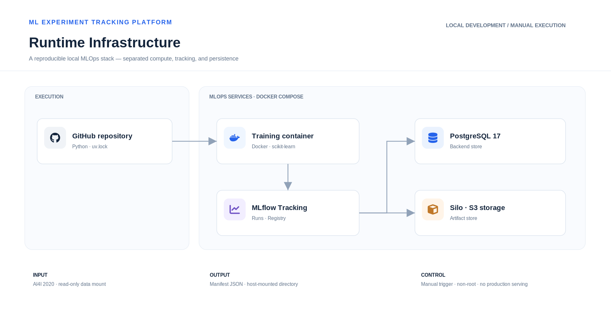
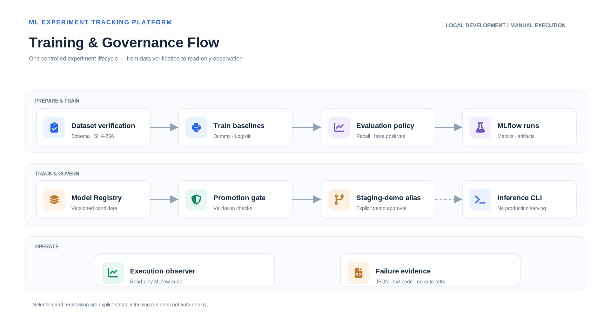

# Architecture & Technical Design

> **ML Experiment Tracking Platform** — A reproducible, containerized
> machine learning experimentation platform demonstrating practical
> MLOps engineering, model governance, and operational reliability.

This document describes the architecture implemented in the
laboratory, including infrastructure components, data flows,
training execution, experiment tracking, model lifecycle
management, and operational boundaries.

**Project:** Predictive Maintenance Binary Classification

**Environment:** Local development using Linux/WSL2 and Docker Compose

**Scope:** Experimental MLOps platform — not a production deployment

---

## 1. Architecture at a Glance

The platform follows a separation-of-concerns approach with
four logical responsibilities:

| Layer | Responsibility | Technologies |
|---|---|---|
| Data & Training | Data integrity, preprocessing, model training and evaluation | Python, pandas, scikit-learn |
| Experiment Management | Store experiment metadata, metrics, parameters, and artifacts | MLflow, PostgreSQL, Silo (S3-compatible) |
| Model Governance | Model versioning, validation gates, and demo lifecycle transitions | MLflow Model Registry, Python |
| Operations | Containerized execution, CI, runtime verification, incident evidence, and observability | Docker Compose, GitHub Actions, pytest, Ruff |

The architecture is designed to provide:

- Reproducible experiments with pinned Python dependencies.
- Explicit dataset provenance and deterministic train/validation/test splits.
- Persistent experiment tracking independent of training execution.
- Controlled model registration and promotion eligibility checks.
- Traceable execution identifiers associated with source revisions.
- Operational evidence for successful and failed executions.
- Local and containerized training using the same core application code.

The design intentionally avoids introducing heavyweight
orchestration platforms before they are required.

---

## 2. Infrastructure Architecture



**[Open editable infrastructure diagram](infrastructure.drawio)**

### 2.1 Runtime components

| Component | Role | Persistence / Connectivity |
|---|---|---|
| Developer workstation | Initiates local workflows, manages source code, and inspects results | Linux/WSL2, Git, uv |
| Training container | Runs the Python training pipeline in an isolated environment | Docker network, read-only dataset mount, writable outputs mount |
| MLflow Tracking Server | Central API for experiment tracking and model registry operations | HTTP endpoint, PostgreSQL backend, S3-compatible artifact storage |
| PostgreSQL 17 | Persists MLflow experiment and registry metadata | Docker-managed persistent storage |
| Silo | S3-compatible object storage for experiment artifacts | Docker-managed persistent storage |
| Local dataset | Supplies the version-validated training inputs | Mounted read-only inside the training container |
| Pipeline outputs | Stores execution manifests and failure evidence | Host-mounted output directory |

### 2.2 Execution modes

The platform supports two explicit execution modes.

**Local Python execution**

The pipeline runs from the developer environment using
Python 3.12, uv, and the locked project dependencies.

```bash
unset PIPELINE_GIT_COMMIT

MLFLOW_TRACKING_URI=http://127.0.0.1:5000 \
  uv run --locked python scripts/run_training_pipeline.py
```

**Containerized execution**

The same pipeline runs inside a dedicated Docker image,
using a non-root user and controlled filesystem access.

```bash
export TRAINING_UID="$(id -u)"
export TRAINING_GID="$(id -g)"
export PIPELINE_GIT_COMMIT="$(git rev-parse HEAD)"

docker compose \
  -f compose.yaml \
  -f compose.training.yaml \
  run --rm --no-deps training
```

Both modes communicate with the same MLflow Tracking Server.

The container resolves MLflow by its internal Docker service name;
local Python execution uses the host-bound endpoint.

### 2.3 Persistence boundaries

The platform separates experiment metadata from artifact storage.

**PostgreSQL**

Stores MLflow tracking metadata, including experiments,
runs, and model registry records.

**Silo (S3-compatible)**

Stores artifacts produced and managed through MLflow,
including model-related files and experiment evidence.

**Host output directory**

Stores pipeline execution manifests independently
of the MLflow artifact store.

A successful training execution generates a manifest at:

```text
outputs/pipelines/<execution-id>/manifest.json
```

A failed execution may generate:

```text
outputs/pipelines/<execution-id>/failure.json
```

These files support investigation and execution traceability.

Persistent storage must be preserved during routine operations.

In particular, `docker compose down -v` should not be
used as a normal shutdown procedure.

---

## 3. MLOps Lifecycle



**[Open editable MLOps lifecycle diagram](mlops-lifecycle.drawio)**

The diagram presents the logical lifecycle from data validation
to experiment tracking, model governance, and operational verification.

The stages are connected conceptually but are not all
executed by a single fully automated deployment workflow.

### 3.1 Data integrity and preparation

The project uses the AI4I 2020 predictive maintenance dataset.

Dataset processing includes:

- Raw dataset integrity verification using SHA-256.
- Explicit schema and feature selection.
- Leakage-aware feature preparation.
- Deterministic train/validation/test splitting.
- Reproducibility verification.

The dataset is split using seed `42`:

| Partition | Share | Records | Purpose |
|---|---:|---:|---|
| Training | 60% | 6,000 | Fit candidate models |
| Validation | 20% | 2,000 | Evaluate models and apply selection criteria |
| Test | 20% | 2,000 | Held-out final evaluation |

The held-out test partition is deliberately excluded
from repeated training and threshold selection.

### 3.2 Training and evaluation

The implemented baseline experiments include:

- Dummy Classifier.
- Logistic Regression with the default classification threshold.
- Logistic Regression using the selected decision threshold.

Evaluation includes precision, recall, F1 score,
and average precision.

The selected model configuration uses a decision
threshold of `0.20`.

The validation selection policy includes:

```text
Minimum recall:         0.40
Maximum false positives: 50
```

Model selection is based on validation evidence,
not the held-out test partition.

### 3.3 Experiment tracking

MLflow centralizes the record of each training experiment.

Each run contains applicable:

- Experiment and run identifiers.
- Model configuration and hyperparameters.
- Dataset provenance.
- Validation metrics.
- Evaluation artifacts.
- Source revision metadata.

The automated training pipeline also groups runs by:

```text
pipeline_execution_id
```

This identifier connects multiple model runs to one
training pipeline execution.

A separate manifest records the relevant Git commit,
dataset SHA-256, run IDs, and resulting metrics.

### 3.4 Model Registry and governance

The registered model is:

```text
predictive-maintenance-classifier
```

The project includes:

- Versioned model registration.
- Registry metadata validation.
- Inference contract verification.
- Read-only promotion eligibility checks.
- Demo approval and staging lifecycle transitions.

The demonstration workflow supports:

```text
Candidate
   |
   v
Promotion eligibility validation
   |
   v
Demo approval
   |
   v
Staging-demo activation
```

Approval and activation are explicit actions.

**The `staging-demo` alias is not a production deployment.**

The project does not currently expose a production serving
endpoint or perform a real production rollout.

The demonstration rollback operation removes
the `staging-demo` alias; it does not restore a
previously deployed production version.

### 3.5 Inference

Registered model inference is performed through a Python CLI.

The inference contract uses the explicit selected threshold
instead of assuming that the model's default `.predict()`
behavior represents the selected decision policy.

This keeps the decision threshold visible, testable,
and independent of the underlying probability estimator.

---

## 4. Training Pipeline Design

The training pipeline coordinates existing application components.

Its primary execution path is:

```text
Source revision validation
          |
          v
MLflow availability check
          |
          v
Dataset integrity verification
          |
          v
Baseline experiment execution
          |
          v
Persisted MLflow run validation
          |
          v
Run metadata and source tagging
          |
          v
Execution manifest generation
```

Each successful invocation creates three new MLflow runs.

Training is intentionally triggered on demand.

The project does not implement automatic retraining
or scheduled training.

### 4.1 Execution traceability

A training execution is associated with:

| Identifier | Purpose |
|---|---|
| `pipeline_execution_id` | Correlates all runs in one pipeline execution |
| Git commit SHA | Identifies the declared source revision |
| Dataset SHA-256 | Identifies the training dataset |
| MLflow Run ID | Identifies an individual experiment |
| MLflow Experiment ID | Identifies the experiment collection |
| Model version | Identifies a registered model artifact |

For containerized training, the source revision is
provided through `PIPELINE_GIT_COMMIT`.

The current implementation checks the SHA format,
but does not cryptographically verify that the
container image corresponds to that revision.

### 4.2 Failure handling

The pipeline includes controlled failure injection,
structured failure events, and failure manifests.

When execution fails, it can produce:

```text
PIPELINE_FAILED
```

The process exits with a nonzero status and records
the execution ID, failure classification, timestamps,
and recovery guidance.

Retries are not performed automatically.

The implementation does not yet guarantee reconciliation
of every run created before a partial training failure.

---

## 5. Operational Observability

The project includes a read-only execution observer.

It compares a completed pipeline manifest against
the metadata and metrics persisted in MLflow.

The observer validates:

- MLflow experiment association.
- Expected run identities and completion status.
- Dataset provenance.
- Source revision and execution tags.
- Persisted evaluation metrics.

The observer emits structured JSON events:

```text
PIPELINE_OBSERVATION_STARTED
RUN_VERIFIED
PIPELINE_HEALTHY
```

If an inconsistency is detected, the observer
reports an unhealthy execution and returns a
nonzero exit code.

This is **training execution observability**.

It does not constitute production prediction monitoring,
concept drift detection, or model performance monitoring
against live ground-truth labels.

---

## 6. Security and Reliability

The laboratory includes several defensive controls.

### Container runtime

- Non-root training user.
- Read-only container root filesystem.
- Read-only dataset mount.
- Writable output mount for execution evidence.
- Dropped Linux capabilities.
- `no-new-privileges` security configuration.
- Pinned base image digest.
- Dependency installation from `uv.lock`.

### Development and CI

- Ruff linting and formatting.
- Automated pytest test suite.
- Dataset integrity verification.
- GitHub Actions quality workflow.
- Manual workflow dispatch to avoid unnecessary CI usage.
- Minimum GitHub Actions token permissions.

### Model governance

- Explicit model evaluation criteria.
- Read-only promotion validation.
- Distinction between candidate eligibility,
  demonstration approval, and deployment.
- No automatic production promotion.

These safeguards reduce risk but do not make
the local laboratory production-hardened.

---

## 7. Architectural Decisions

| Decision | Rationale | Trade-off |
|---|---|---|
| Python and scikit-learn | Simple, testable, maintainable ML baseline | Limited to the project's current modeling scope |
| MLflow | Centralized experiment tracking and registry | Requires supporting infrastructure |
| PostgreSQL backend | Durable, queryable tracking metadata | Database lifecycle must be managed |
| S3-compatible artifact storage | Separates large artifacts from tracking metadata | Storage configuration and persistence add complexity |
| Docker Compose | Reproducible local multi-service environment | Not a high-availability orchestrator |
| uv with lockfile | Controlled dependency resolution | Lockfile must be kept current |
| On-demand training | Avoids redundant runs and unnecessary infrastructure usage | No scheduled retraining |
| Separate validation and test sets | Reduces evaluation leakage | Requires careful experiment discipline |
| Explicit promotion gates | Makes governance decisions auditable | Does not replace production approval processes |
| Structured execution evidence | Supports diagnosis and traceability | Not a complete observability platform |

### Why not Kubernetes, Airflow, or Kubeflow?

The current application contains a small number of
coordinated training tasks and a local tracking stack.

Introducing a distributed orchestrator at this stage
would add operational overhead without demonstrating
a corresponding workload requirement.

The containerized execution model allows future
integration with Kubernetes Jobs or workflow engines
if scheduling, scale, or execution isolation requires it.

---

## 8. Known Limitations

This architecture is intentionally scoped to a portfolio lab.

It does not currently include:

- Highly available infrastructure.
- A production inference service.
- Production deployment automation.
- Online prediction monitoring or drift detection.
- Automatic retraining schedules.
- Safe automatic retry and partial-run reconciliation.
- Verified image-to-source provenance.
- Centralized log aggregation or distributed tracing.
- Validated production backup and disaster recovery procedures.

These are possible future extensions,
not implemented project capabilities.

---

## 9. Operational Documentation

For execution instructions and incident procedures:

- [Training Operations Runbook](../runbooks/training-operations.md)
- [Incident Response Runbook](../runbooks/incident-response.md)

For the project overview, results, technology stack,
and quickstart, return to the
[main project README](../../README.md).

---

## 10. Diagram Maintenance

Both diagrams are provided in two formats.

| Format | Purpose |
|---|---|
| `.png` | Rendered preview in GitHub Markdown |
| `.drawio` | Editable source diagram |

To edit a diagram:

1. Open [diagrams.net](https://app.diagrams.net/).
2. Select **File > Open From > Device**.
3. Open the corresponding `.drawio` file.
4. Make the necessary changes.
5. Export the updated diagram as PNG.
6. Commit both the `.drawio` source and PNG preview.

Keep the architecture diagrams synchronized with
the actual implementation.

Do not introduce infrastructure components or
production capabilities into diagrams unless
they are implemented or clearly marked as future state.

---

**Architecture principle:** prioritize traceability,
reproducibility, explicit governance, and operational
clarity over unnecessary platform complexity.
